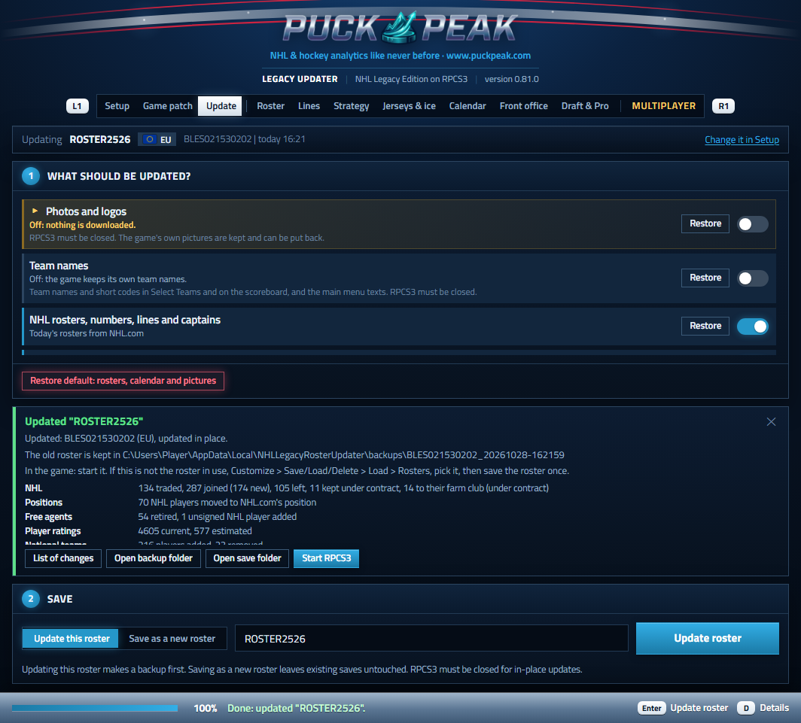
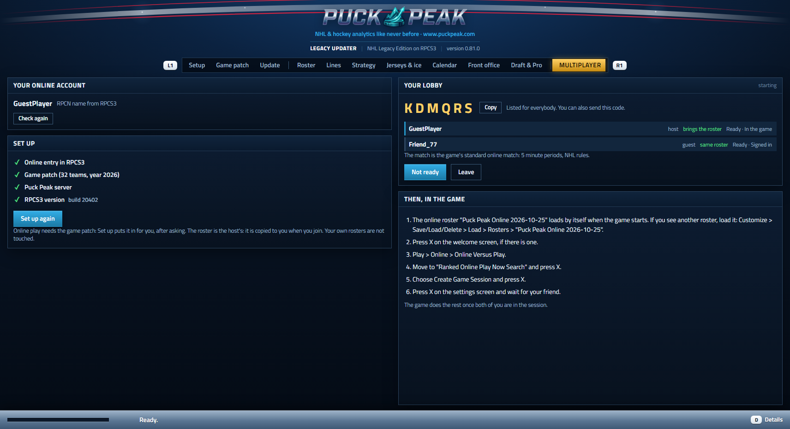
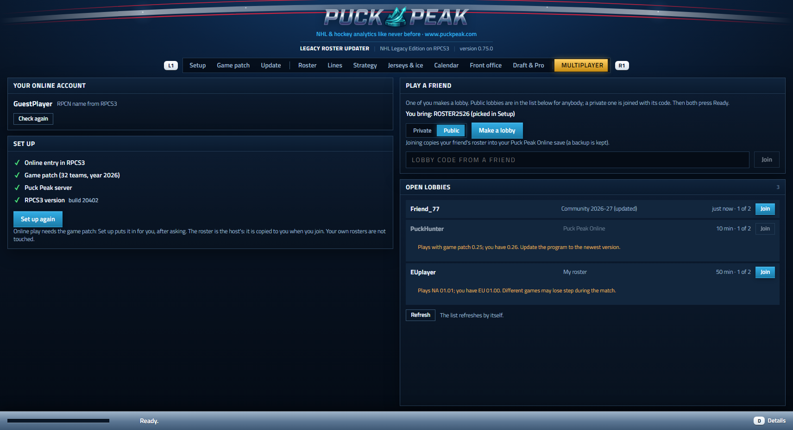
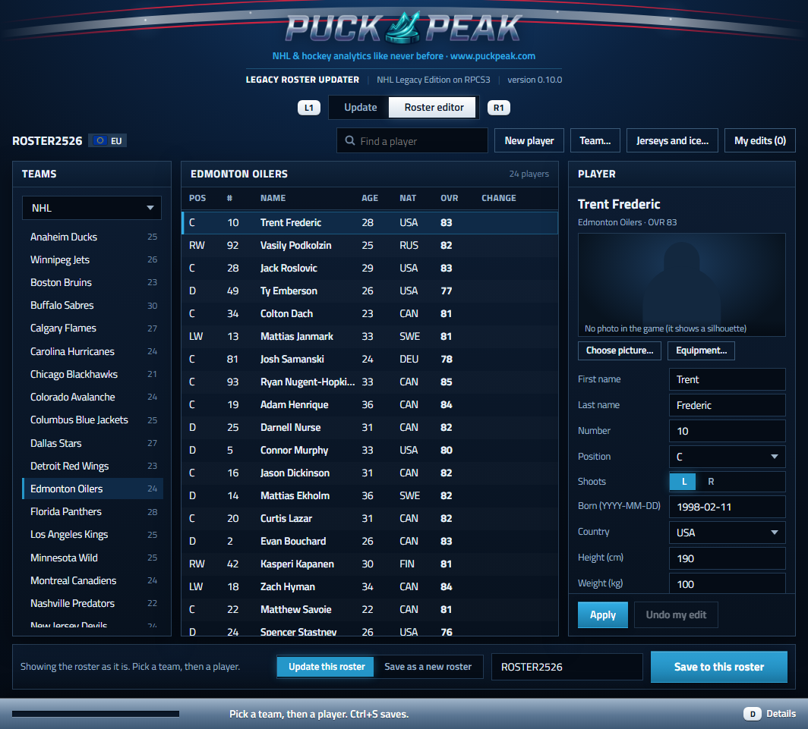
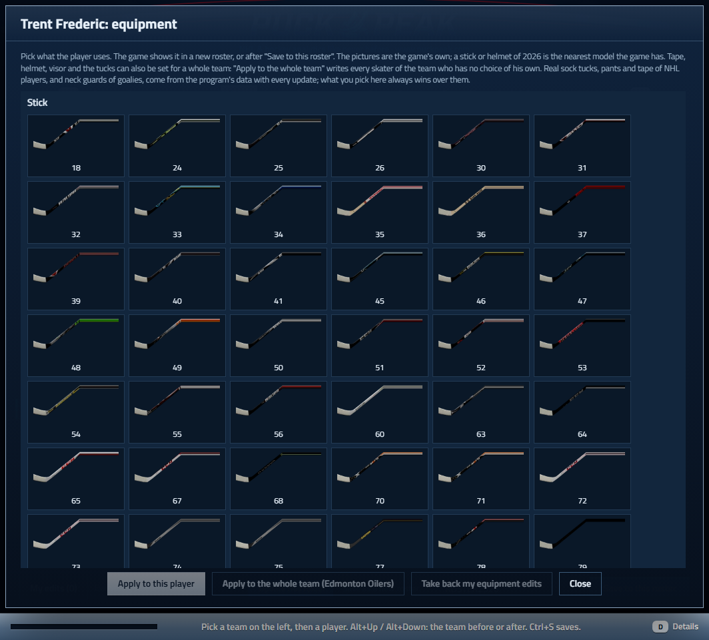
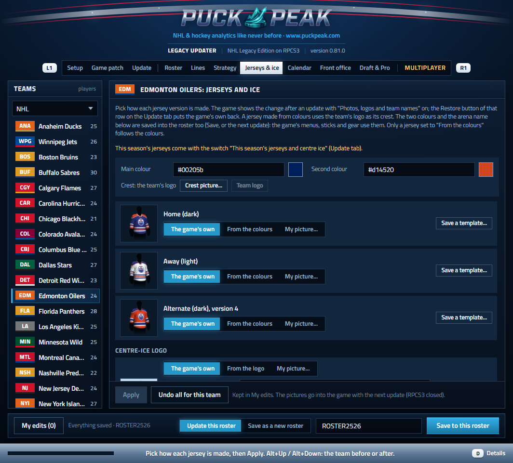
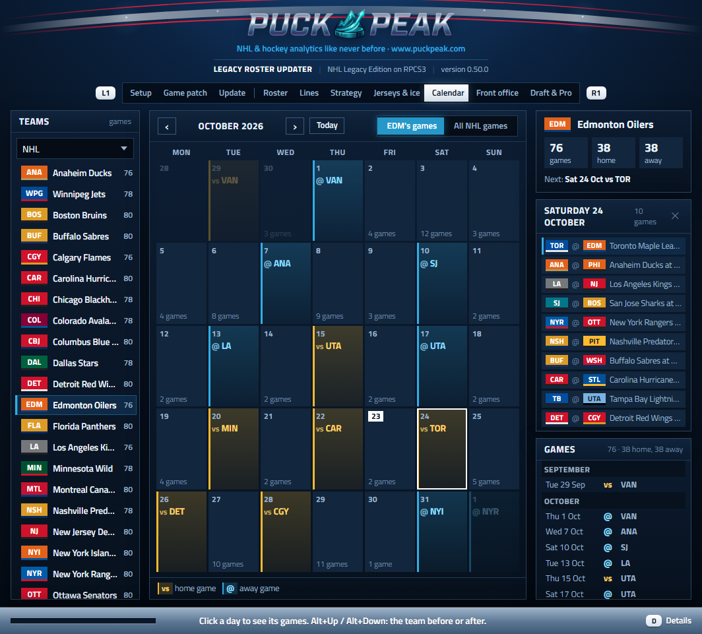
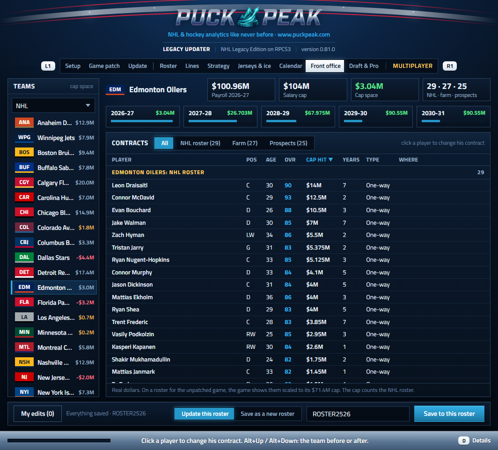
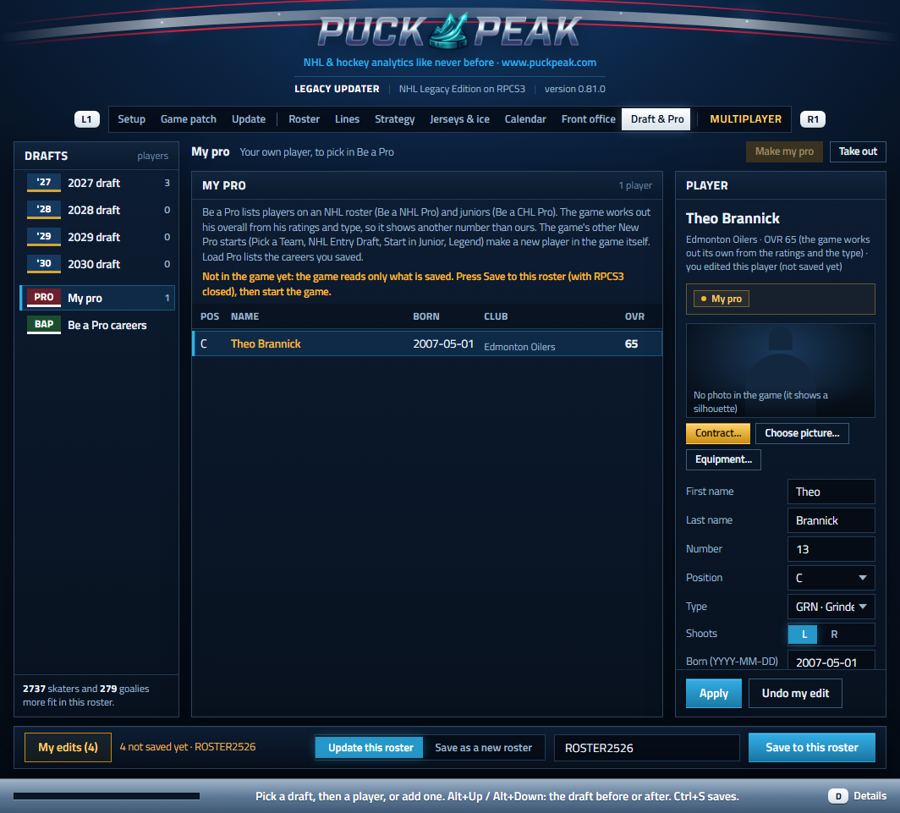

<div align="center">

# 🏒 Puck Peak Legacy Updater

### The ultimate toolkit for **NHL Legacy Edition** on PS3 / RPCS3.
*One click and your 2014 game plays the 2026-27 season.*

[**⬇ Download the latest version**](https://github.com/MatusRiedl/puckpeak-nhl-legacy-updater/releases/latest)
&nbsp;·&nbsp; [Quick start](QUICKSTART.md) &nbsp;·&nbsp; [What's new](CHANGELOG.md)

[](https://gg.puckpeak.com)

Questions, news and help: **[gg.puckpeak.com](https://gg.puckpeak.com)**



</div>

## ✨ Highlights

- 🏟 **Today's NHL, in your old game.** Every player on his real team, lines, captains, contracts, draft, ratings.
- 🌍 **The whole hockey world.** National teams plus Liiga, Extraliga, SHL, DEL, National League, AHL and the CHL, with real rosters.
- 📸 **Real faces, real logos, real names.** Today's photos and club logos in the game's menus; Utah, Seattle and Vegas as they should be.
- 👕 **New jerseys and ice.** The new franchises get their own jerseys, helmets and centre-ice logo, and you can paint your own for any team of any league.
- 🎮 **Multiplayer (beta).** Make a lobby with your roster, share a six-letter code or pick an open game, press **Ready**: RPCS3 starts on both PCs and goes straight to Select Teams. Europe and US, game 1.00 and update 1.01. Chat with your friend, climb the **ranks** and the public **leaderboard**, see **your stats** and a **box score** for every match ("Show me on the leaderboard" takes your name off), and on Windows see chat and the result card **over the game**.
- 🗓 **The real 2026-27 calendar.** Played in Season mode, and shown month by month in the program, with the results of your own Season.
- 🏒 **32 teams in Season, Be a GM and Be a Pro.** An optional game patch adds Seattle and Vegas, their AHL farm clubs, the year 2026 and 84 games; one button takes it out again.
- 🎓 **Draft & Pro.** Draft classes for a new Be a GM or Season, your own player for Be a Pro, and the name, ratings and XP of a Be a Pro career you already play.
- ✏️ **A full Roster editor, no limits.** Add yourself, put anyone on any team, any player type. Ratings, numbers, teams, photos, new players, jerseys, **lines and strategies**, **contracts and the salary cap**, and **real-life equipment**: sticks, tape, helmets, gloves, skates and tucks.
- 🥅 **Goalies too.** Pads, blocker, trapper, mask, and **your own picture on the mask**.
- 🔒 **Safe.** Your save is backed up first, every result passes a safety check, and one button puts the game's own roster back.
- 🔄 **Stays fresh.** Checks for new versions itself and updates in one click.

<div align="center">
 
 
 
 
</div>

## 🚀 Get started

1. Download `PuckPeakLegacyUpdater.exe` (about 26 MB, Windows) or `PuckPeakLegacyUpdater-<version>-linux.tar.gz` (Linux) from the release page.
2. In **Setup**, show it where `rpcs3.exe` is and pick a roster. In **Update**, switch on what you want and press **Update roster**.
3. Start the game. That is all.

No roster yet? It can start from the game's own. Built for the NHL Legacy community, by [Puck Peak](https://www.puckpeak.com).
Questions or ideas? Come to our [Discord](https://gg.puckpeak.com) (the **Join our Discord** button at the top of the Setup tab).

<details>
<summary><b>Everything it does, in detail</b></summary>

## What it updates

| | What happens | Where the data comes from |
|---|---|---|
| NHL | Every player on his current team, at the position NHL.com lists, with jersey numbers, lines (left wings on the left, right wings on the right), captains, contracts, and NHL.com's height, weight and hand | NHL.com, fetched when you press the button |
| Free agents | Retired players leave the free-agent list; NHL players without a contract today are on it (added to the game if it did not have them) | NHL.com: who played in the NHL last season |
| Draft | Every player's real draft: year, round, pick and team | NHL.com draft lists since 2005 |
| Ratings | Current player attributes, in every league | Current ratings for 2026-27 |
| National teams | Squads refreshed; every empty national team filled (also the ones a community roster left empty) | IIHF 2026 rosters and NHL players by nationality |
| Liiga | The 15 Finnish clubs with their real 2026-27 rosters, lines and captains | liiga.fi |
| Extraliga | The 14 Czech clubs likewise | hokej.cz |
| SHL | The 14 Swedish clubs | shl.se |
| DEL | The 14 German clubs | penny-del.org |
| National League | 12 of the 14 Swiss clubs | nationalleague.ch |
| Norway | Stavanger and Vålerenga, the two Norwegian clubs the game has | ehl.no |
| AHL | All 32 AHL teams with their real rosters; players on NHL contracts belong to their NHL club | theahl.com (HockeyTech) |
| CHL | The OHL, QMJHL and WHL clubs; a junior missing from his league's list stays with his club | the leagues' sites (HockeyTech) |
| Draft prospects | Undrafted prospects of the next drafts play for a real club of their country (the CHL for North Americans), where the game's draft finds them, instead of on custom "Prospects" teams | the community roster's prospect lists |
| Photos and logos | Today's player photos and club logos in the game's menus (the National League publishes no photos) | the leagues' sites, downloaded on your PC (see below) |
| Team names | Real team names and short codes (Utah, Seattle, Vegas, rebuilt clubs) in Select Teams and on the scoreboard; nothing to download | made on your PC |
| This season's jerseys and centre ice, arenas, team goalie masks | Optional picture switches, each downloads only its own small pack (see below) | downloaded from the program's file server |
| Goalie equipment | A goalie who changed teams wears his new team's colours | the team's colours in the game |

Everything is switched on to start with; switch off what you do not want. Every part passes the
program's safety check; SHL, DEL, National League, Norway, AHL and CHL have not been played in the
game by the project owner yet. Tell us how they work.

## No roster yet? Start from the game's own

You do not need a community roster. If RPCS3 lists the game, **Setup** shows **The game's own
roster** (marked *start fresh*) under your saves. The program reads it from your copy of the game,
the 2014-15 players, and brings it up to today:

- Seattle and Vegas move into the All-Star teams' places. With "Team names" on,
  Utah, Seattle and Vegas show their names and logos in the NHL list.
- Players of 2014 who are 30 or older and on no team any more retire, unless they played in the
  NHL last season: those become free agents. Their places in the save go to today's players.
  Younger ones become free agents.
- The national teams are filled again with today's players.
- Coachella Valley and Henderson are left out: the game's own roster has no team for them. Make a
  team of your own with that name and the update fills it (below).
- The first roster of a game that has no save yet gets the game's own icon. A new roster is saved as `...01` (never `...00`,
  the game's own save slot).
- **RPCS3 does not list your game?** (a fresh RPCS3, or a game that is not in its games list) Setup then shows
  **Pick the game (.iso)...** and **or its folder...**. Pick the game's `.iso` file, or the folder that holds `PS3_GAME`;
  the program remembers it and starts from the game's own roster. Command line: `--game <iso or folder>`.

This is new in 0.6.0 and has not been played in the game yet. Tell us how it works.

## Your own team for a missing club

The game has no place for some real clubs: Jokerit and Jukurit (Liiga), Ajoie and Rapperswil-Jona
(National League), Penticton (WHL), several Norwegian clubs, and, in the game's own roster,
Coachella Valley and Henderson (AHL). Make a team in the game yourself, name it after the club
("Jokerit", "Penticton Vees"), save the roster, then update it: your team gets the club's real
players. It keeps the name, city and logo you gave it, and it stays with the other custom teams
(for exhibition games), because the game does not let a custom team join a league. Do not rename
one of the game's own teams instead: the update gives that team its real club back.

## Linux

The Linux program has the same window and tabs as the Windows one. On Linux, RPCS3 keeps its saves in
`~/.config/rpcs3` (`~/.var/app/net.rpcs3.RPCS3/config/rpcs3` for the Flatpak). The program finds that folder by
itself; if it does not, press **Find RPCS3** in Setup and pick your RPCS3 AppImage, the `rpcs3` program or that folder.

- **Download:** `PuckPeakLegacyUpdater-<version>-linux.tar.gz` from the release page. Unpack it and start
  `PuckPeakLegacyUpdater` in the folder (on a Steam Deck in Desktop Mode). Nothing to install: it brings its own web
  engine. 64-bit Linux from 2022 or newer (Ubuntu 22.04, Debian 12, Fedora, Arch, SteamOS 3).
- **Mac:** there is no Mac program (since 0.80.1). Run it from source (below) with Python 3.10 or newer and
  `pip install pywebview pillow`, or use **Export files to a folder** on another PC.

## Without RPCS3 (a Mac, a Linux PC, CrossOver, Wine)

Tick **"Export files to a folder"** in **Setup**, under **Where is RPCS3?**. It works on every system, with or
without RPCS3 (Windows, Linux, Flatpak, Mac, CrossOver, Wine). The program then changes nothing in RPCS3: on the
**Update** tab press **Export files** and a new folder `NHL Legacy export <date time>` appears next to the program
(or where you ask on the command line). It is laid out like RPCS3's own folders: `dev_hdd0/game/<game>/USRDIR/...`
(pictures and names), `dev_hdd0/home/<user>/savedata/<game>02NN/` (the roster), `patches/` (the game patch), and a
`HOW-TO-INSTALL.txt`. When it is ready, the window "Your files are ready" tells you, for your system (Windows, Linux,
Flatpak or Mac), where RPCS3's folder is and how to copy each part in (on a Mac, merge the folders; do not replace
`dev_hdd0`), which entries to tick in RPCS3 under **Manage > Game Patches**, how to load the roster, how to undo it
(delete what you copied), and what to do when a roster of that name already exists (rename it to a free `...02NN`).
Without RPCS3, **Which roster do you work on?** asks for the roster file: pick the `SYS-DATA` of the community
roster you downloaded. The picture switches, the game patch and the game's own roster need your copy of the
game: pick the .iso (or its folder) in Setup. Restore, "Update this roster", Play online and the Be a Pro / Season
saves are off while you export, because they change RPCS3 itself. On the command line:
`export-files [--rpcs3 <rpcs3> | --savedata <folder> | --source <SYS-DATA>] --out <folder> [--photos] [--game-patch]
[--version EU|NA|both] [--game <iso>]` (it prints the same text). `export-roster --file <SYS-DATA>` still makes just
the roster file.

Pointing the program at a folder of roster saves instead still works on the command line
(`--savedata <folder>` instead of `--rpcs3`).

## EU and NA

The European (`BLES02153`) and North American (`BLUS31540`) versions of the game read the same
roster file. The program finds the rosters of both and marks each one **EU** or **NA**. If your
RPCS3 has both versions, **Save for** (on the Update tab, next to the roster name) saves the new roster
for EU, NA or both. It can even make the first roster of a version that has none yet. Photos, logos and team
names then go into both games too.

**About the club leagues.**

- **The game cannot hold more teams than it has slots.** These clubs are left out:
  - Liiga: Jokerit and Jukurit;
  - National League: Ajoie and Rapperswil-Jona;
  - WHL: Penticton;
  - Norway: every club except Stavanger and Vålerenga.
- **A club new to a league since 2015 takes the slot of one that left,** and keeps the old club's jersey.
  Its logo and its name in the menus are the old club's unless "Team names" is on
  (the game takes team names from its own text, not from the roster):
  - Kiekko-Espoo plays in the Espoo Blues slot;
  - Kladno in Chomutov's, České Budějovice in Zlín's;
  - Björklöven in Karlskrona's, Timrå in MODO's;
  - Frankfurt in Düsseldorf's, Bremerhaven in Hamburg's;
  - the AHL's Hamilton Hammers in Bridgeport's.
- **Prospect pools.** The community roster uses the European club slots for draft classes and NHL
  prospect pools. When a league gets its real clubs, pool players who are not on a real club move
  to spare custom teams named after their pool (under CUSTOM). There is room for 16 such teams of
  40. The best prospects keep their place; the rest become **free agents**, who keep their NHL
  rights and can be signed.
- **Players who leave a club** become free agents too. Nobody is deleted from the save.
- **Room for new players is limited.** The save has a fixed number of player records. New players take
  over blank records and those of long-retired, low-rated players (never legends, prospects or free
  agents). With every league switched on the records run out. Every club still gets the players it
  needs for a full line-up, but some junior depth players are skipped; the List of changes names them.
- **Ratings.** Players the current ratings do not cover are rated by estimate (league level, age,
  role).
- **What the leagues do not publish:**
  - The DEL lists each player's age, not his birthdate. A DEL player new to the game gets 1 July of the
    fitting year (the List of changes marks him).
  - The National League does not publish nationality, so its players new to the game are listed as Swiss.

**Pictures and team names.** Step 4 of the Update tab has **Team names** (its own switch, on to start with) and
**Photos and logos**. Press the arrow of Photos and logos to choose its parts, or switch the row on and every part comes
with it, so you download only what you want:

| Switch | What it does | Download |
|---|---|---|
| Photos and logos: Player photos and team logos | Current player photos and club logos | about 105 MB |
| Team names | Real team names and short codes, the main menu texts | none |
| Photos and logos: This season's jerseys and centre ice | New jerseys with their own names and numbers, pants, socks and centre-ice logos; 30 NHL teams get centre-ice logos with the arenas' current names, the clubs this season's (Seattle and Vegas play at home on Nashville's) | about 88 MB |
| Photos and logos: NHL arenas | Newer boards and banners in the 32 NHL arenas | about 13 MB |
| Photos and logos: Team goalie masks | The goalie masks of the teams | about 3 MB |

Each row has its own **Restore** that puts back only its own files. Photos and logos give the players
their current photo and the clubs their current logo. Team names give, for example: Kladno
instead of Chomutov; Utah, Seattle and Vegas instead of Arizona, Green and Black; names for
Coachella Valley, Henderson and the prospect pools. The game takes team names from its own text
file, so the program writes a corrected copy of that too. In detail: Kladno
instead of Chomutov; Utah, Seattle and Vegas instead of Arizona, Green and Black; names for
Coachella Valley, Henderson and the prospect pools. The game takes team names from its own text
file, so the program writes a corrected copy of that too:

- **RPCS3 must be closed** while it runs.
- **Downloaded automatically.** While the switch is on, the program downloads its pictures by itself
  in the background (once, and again only when they change; each switch has its own size, listed above), and the next update puts
  them in. Players new since then are downloaded one by one. Everything is kept on your PC, so no
  picture is downloaded twice. Switch it off and nothing is downloaded.
- **Made for your game.** The pictures are turned into the game's own picture files on your PC,
  using templates from your copy of the game. Writing them takes a few minutes and about 600 MB.
- **Where they go.** The pictures and team names go into RPCS3's folder for the game
  (`dev_hdd0\game\BLES02153` for EU, `dev_hdd0\game\BLUS31540` for NA), not into your roster saves.
  A roster file (`SYS-DATA`) holds only each player's picture number. So a roster file you download
  and drop into a save folder does not bring or remove pictures: it shows the ones installed for
  the numbers it uses.
- **Custom teams** (under CUSTOM: the copies of 12 NHL teams with today's logos and jerseys,
  Coachella Valley, Henderson, the prospect pools) get a name in the menus as well.
  Coachella Valley and Henderson also get their crest on the centre ice and the jerseys (the game draws them with
  create-a-team logos 72 and 80, so a team you build with one of those logos shows it too). A crest picture you give a
  custom team on the Jerseys & ice tab goes onto a create-a-team logo no other team uses.
- **The favourite team screens** ("Choose Your Favorite Team" when you start the game, and the
  favourite team in your settings) get the current logos too: Utah's instead of the Coyotes'.
- **The main menu** leaves out Hockey Ultimate Team, View Player Hub, Leaderboards and Lobby (their online servers
  are gone). The old offline news and the "new tuner set" notices say "Puck Peak" and
  "www.puckpeak.com"; the community server's own news stays.
- **Your own pictures are kept.** Before a picture is replaced, the one that was there is kept on
  your PC: the game's own, or one from a picture pack you installed yourself. If you install
  another pack later, its pictures are kept as well.
- **Undo.** **Restore** on a picture row puts that part's files back as they were
  with the next save; **Restore default** also puts back the rosters and the calendar.
- **Not covered:** the National League and Extraliga publish no player photos, so their players
  keep the game's pictures. Their club logos are covered.

**The team tabs: Roster, Lines, Strategy, Jerseys & ice, Calendar and Front office.** These six tabs show
what a roster holds and let you change it. They share one team list on the left: pick a league, then a
team. The team stays picked when you change tab, so you can look at its lines, then its strategy, its
jerseys, its games and its contracts. **Alt+Up** and **Alt+Down** go to the team before or after. Next to
each team is a number that fits the tab: players, games or cap space.

- **They show the roster you picked** in Setup, as it is now (the game's own roster too).
  Gold players are the ones you changed in this visit (the edits you made earlier are in the roster
  once you saved it).
- **One Save bar** under Roster, Lines, Strategy, Jerseys & ice and Front office (see "Save" below).
  Changes you have not applied yet stay with their team when you click another team.

**Roster.** Every team and player with position, number, age, nationality and overall, with the
player's photo.

- **The photo** on the right is your own picture of the player, or the one the game shows now.
- **Edit any player.** Name, number, position, **player type** (PLY, SNP, TWF ...), shooting side, birthdate,
  country, height, weight, team (or free agent), every rating, his **face** (the head, skin and eye colour: take
  another player's with "Face of a player...", or pick one of the game's generic heads by its picture), and a **photo of your own**
  (any PNG or JPG; you see it as the game will). Then **Apply**. **Equipment...** sets his stick, tape, helmet,
  gloves, skates and tucks (a goalie's mask, pads, blocker and trapper too); **Contract...** opens his contract
  (see Front office).
- **Edit any team.** Full name, city, abbreviation and a **logo of your own** ("Team...").
- **New player.** Give a name, birthdate, team and overall. The save has a fixed number of player
  records, so new players use spare ones.

**Lines.** Set a team's four lines, three pairs and goalies, the power play, the penalty kill, overtime, the
shootout shooters, the extra attackers, and the captain and alternates. Click a place, then a player. The tab
says what the game would not accept (for example a goalie on a line). A later update keeps your lines while all
those players are still on the team.

**Strategy.** A team's forecheck, pressure, power play and penalty kill, and the sliders of every line and
pair (carry or dump, block shots, pinch ...), with the words of the game's own Strategy menu. The computer plays
the team with them.

**Jerseys & ice.** Every team's jerseys and centre-ice logo: this season's, the game's own, made from the team's colours,
or your own picture. The custom teams (the 12 NHL copies, Coachella Valley, Henderson, the prospect pools) are drawn
like Create a Team teams: pick a
crest, the jersey, pants, socks and numbers from the game's own pictures, type three colours to paint everything,
then fine-tune each piece for home and away. The national teams share one centre ice, and so do the DEL clubs: a
picture you put there shows at all their home games. Winter Classic teams wear their NHL team's jerseys: the tab
shows that team's jerseys, and a change shows on both. Jerseys, crest pictures and the ice show in the game after an
update with "Photos and logos" on; a custom team's designs and colours come with "My edits" alone.

**Calendar.** The season on a month page, Monday to Sunday, with arrows for the month before and after.

- **The team you pick** has its games marked: "vs EDM" at home in gold, "@ CGY" away in blue. The other days
  show how many games there are. **All NHL games** shows every game instead.
- **Click a day** to see all its games. The team's games are also listed on the side, month by month; click
  one to go to its day.
- It is the NHL's real 2026-27 calendar as your roster holds it. On a roster for the patched game, the AHL's
  calendar is there too (pick a farm club).
- **My season.** Switch it on and the calendar shows your latest Season or Be a GM save: the games you have
  played with their scores (won in gold, lost in blue, OT and SO marked), today's date in your season, the next
  game and the playoffs. The program only reads your save, never changes it, and waits while the game is still
  saving.

**Front office.** An NHL team's money at a glance.

- **Payroll, salary cap and cap space** for this season and the four after it (2026-27 to 2030-31).
- **Every player under contract** with the organisation: the NHL roster, the farm club and the prospects, with
  cap hit, seasons left, one-way or two-way, and an extension he has signed. Click a column to sort by it.
- **Edit a contract.** Click a player (or press **Contract...** on his card in Roster) and set the cap hit, the
  seasons, one-way or two-way, and an extension. The window shows the team's cap space before and after, and
  refuses a deal the game does not allow. **Apply** keeps the deal in My edits; **Save** writes it into the
  roster, and every later update keeps it. Amounts are always real dollars; a roster for the game without the
  patch holds them scaled to the game's $71.4M cap, as every contract is. We have not seen a hand-made contract
  in the game yet: tell us how it works.
- **With My season on** (Calendar), it also shows your team's record, points and place, and the standings.

**Draft & Pro.** Make the players of the next drafts for a new Be a GM or Season, and your own Be a Pro player.

- **The list on the left** has the next four drafts (2027 to 2030) and **My pro**. Click a draft to see its players,
  best first, like a draft board.
- **Add a prospect** opens the Roster editor's card, filled for that draft: give him a name, a club, an overall, and
  anything else the card has. Above the photo you set his **growth tier** (1 = the best: in our test the game took a
  tier 1 player 2nd overall; tier 5 and lower went undrafted) and his **potential** inside that tier's range.
- **Make a class...** makes 16 to 64 made-up players at once: pick how strong the class is and a class number (the same
  number makes the same class again). Names mix first and last names of real players of the same country, never a real
  player's full name. Players from Sweden, Finland, Czechia, Switzerland, Germany or Norway play in their country's
  league, the others in the CHL. Change any of them afterwards.
- **Export...** saves a class as a file to share; **Import...** puts someone's class file into the draft you have open.
  Their birth dates move to that draft, a club your roster does not have is swapped for one of the same league, and a
  name your roster already has is skipped. A window lists what happened.
- **How the game drafts:** a new Be a GM or Season drafts the juniors and European players without NHL rights, by
  birth date (born by 15 September 2009: the 2027 draft). So class players play on a CHL or European club; the window
  marks one that does not. Classes work in the patched game (32 teams, the year 2026).
- **My pro** is your own player for Be a Pro (Live the Life). The program does not start a career: it puts your pro
  into the roster, and you pick him in the game. Press **Save** first (RPCS3 closed): until then the list says "not
  saved yet" in gold, and the game cannot see him. Then in the game: Live the Life > New Pro > **Be a NHL Pro** (or
  **Be a CHL Pro** for a CHL club), his team, his position, and step the Overall filter (it starts on 70-79) until he
  shows. Be a Pro only lists players on an NHL team or a CHL club, so the card offers only those. In the patched game
  put him on an NHL team: a Be a CHL Pro career with an undrafted junior does not start yet. The game works out his
  overall from his ratings and type, so it shows another number than the card. The game's other New Pro starts (Pick
  a Team, NHL Entry Draft, Start in Junior, Legend) make a new player in the game itself; **Load Pro** lists only
  careers you saved in the game.
- **Look...** on the card of a player you make gives him the game's Create Player look: head shape, skin tone, hair,
  facial hair, eyebrows, eyes, scars, freckles, a black eye, with the game's own words and pictures. **Random** makes
  one up; a made class gets random looks. The game keeps 180 places for created faces; a few stay free for its own
  Create Player.
- **Room.** Every class player takes one of the save's spare player records; the list shows how many are left.
- **Save** writes them into the roster, and every later update keeps them (My edits). Closing the window with
  players not saved yet asks first: Save now, Close anyway or Cancel.
- **Into the game:** load the roster (Customize > Save/Load/Delete > Load > Rosters), then start a **new** Be a GM,
  Season or Be a Pro: it takes the classes, looks and your pro from the roster. A career you already play does not
  change. At a career's start the game may move a player within his organisation, for example your pro to the farm
  club.
- **Be a Pro careers** (last in the list) shows the careers you saved in Live the Life, as Load Pro lists them. Pick
  one to see your pro: his type, number and ratings as the career has them. You can change his **first and last
  name** (Load Pro then lists the career under the new name), his **ratings** (40 to 99; the game works out his
  Overall from them; a goalie's not yet) and the **experience points** he has to spend (Offense, Defense, Athletic;
  spend them in the game in Player Growth). **Save this career** asks first, then copies the whole career to the program's backups (the newest
  10 are kept) and changes only what you changed. It works only while RPCS3 is closed and never on a career the game
  saved in the last few seconds. Then load it in the game: Career > Live the Life > Load Pro.

**Your edits are kept** on this PC and applied again after every later update ("My edits" on the
Update tab). The next download therefore does not undo them. **My edits** in the Save bar lists them, and
you can remove any one.

**Save** (or **Ctrl+S**) writes what you see after the same safety checks as an update: **Update this roster**
changes the roster you picked (the old one is copied to the backup folder first), **Save as a new
roster** makes a new one. It is the same choice as on the Update tab.

## What you need

- Windows and RPCS3 with NHL Legacy Edition, European (`BLES02153`) or North American
  (`BLUS31540`), or both.
- A roster to start from: a **community roster** (the 2025-26 roster family or the community's
  2026-27 roster, also a file you put into a save folder by hand), or **the game's own roster**
  (see above). A roster you saved in the game without loading a community roster counts as the
  game's own.

## How to use it

The window has ten tabs in one row: **Setup**, **Update** and **Game patch**, then the team tabs
**Roster**, **Lines**, **Strategy**, **Jerseys & ice**, **Calendar** and **Front office**, and **Draft & Pro** (above).
Ctrl+1 to Ctrl+9 and Ctrl+0 open a tab; Ctrl+PgUp and Ctrl+PgDn go to the tab on the left or right.

1. Download `PuckPeakLegacyUpdater.exe` (Linux: the `-linux.tar.gz`) from the Releases page and start it.
2. **Setup: Where is RPCS3?** Pick the file `rpcs3.exe` in your RPCS3 folder. The program finds your
   saves from there, also when RPCS3 keeps its hard disk somewhere else or has several users. If
   RPCS3 is running, or you have used the program before, this is already filled in. **Downloads**
   shows whether the pictures are on your PC, and **This program** whether it is up to date.
3. **Setup: Which roster do you work on?** Pick the roster to start from. The Update tab, the team tabs
   and their Save all use it. Each one carries the flag of its version (EU or NA); rosters made by this
   program are marked *made here*; rosters it cannot use are greyed out with the reason. The game's own
   roster is at the end of the list. To start a separate roster from the game's own players, choose
   **New from EU disc** or **New from NA disc** when that game is listed in RPCS3. You do not need an
   existing roster save.
4. **Game patch** (optional). **Patch the game** patches NHL Legacy in RPCS3 (every version you have) so
   that Season and Be a GM have Seattle and Vegas: 32 NHL and 32 AHL teams, 84 games, the draft of 32.
   While the game is patched, every update makes a roster for the patched game, from any roster (rosters
   for it are marked *32 teams*). **Unpatch** puts the game back as it was; the next update of a
   *32 teams* roster makes it a roster for the game as it is again. "Skip the intro" (straight to the
   main menu, no Press Start) and "No pop ups at start" (no sign-in boxes when the game starts) are small
   extras of the patch. With "No pop ups at
   start" you can still play online: the game signs in when you open an online mode. RPCS3 must be
   closed. The tab also shows, for the EU and the NA version, what is in the game now, and **What the
   game patch does** explains it all. The patch works with and without the game's update 1.01. If the
   tab says **Patch again** (you patched before the update was installed), press it once.
5. **Update: What should be updated?** Switch on what you want. Then, under **Save**, choose **Update
   this roster** or **Save as a new roster**, and press **Update roster**. It takes about a minute.
   With both versions of the game in RPCS3, choose first who gets the new roster (**Save for**: EU, NA
   or both).
6. In the game: *Customize > Save/Load/Delete > Load > Rosters*, pick the roster with the new date, then save
   it once so the game keeps it as the active roster.

The program updates the roster you picked in Setup (the default) or writes a new folder next to your
existing roster saves (for example `BLES021530205`; choose **Save as a new roster** on the Update tab).
Before it changes a roster it copies the old one to its backups folder (`%LOCALAPPDATA%\NHLLegacyRosterUpdater\
backups`, the last 10 of each roster), so an update can be undone by copying the files back; RPCS3
must be closed. Next to each roster in Setup, **Delete** moves it to the Recycle Bin (you can take it out
again), and **Open folder** shows its folder.

**The game shows at most 10 rosters for each version** (EU, NA). Setup counts them ("7 of 10"); when all 10 are in use
the program makes no new roster: delete one you no longer play, or update a roster in place. A roster the game does not
show (made by an older version of this program) is marked "not in the game".

When it is done, the Update tab shows what each part did, one line each, and offers **List of
changes**, **Open save folder** and, when RPCS3 is not running, **Start RPCS3**. The list of changes
opens in your browser: every trade, call-up, new player and position change, grouped by league and
team, with a search box. The same list is saved as a spreadsheet file next to it.

## Good to know

- **Windows may warn about the exe.** It is not signed. Choose *More info > Run anyway*, or run it
  from source (below).
- **Safety check.** Before anything is saved, the new roster is tested against the rules the game
  enforces (checksums, line-ups, contracts, team limits). If a test fails, nothing is saved.
- **AHL teams** lose players to NHL call-ups. Switch on "AHL rosters" to fill them with their real
  players.
- **New players** who are not in the game's database get a generic face and no commentary name.
  Players the current ratings do not cover keep the ratings they had, or get an estimate.
- **No internet?** Start it with `--offline` on the command line; it uses the data it shipped with.
- **"Could not connect safely"?** Check that the date and time on your PC are right. An antivirus
  that checks web traffic can also cause it: turn its web or HTTPS scanning off for a moment.
- **"Some of this program's files are missing"?** An antivirus or a cleaning program removed them
  while the program started. Start it again, and allow `PuckPeakLegacyUpdater.exe` in your antivirus.
- **Real PS3 console:** saves there are signed. Copy the new save over and re-sign it with a save
  tool such as Apollo. This is untested.

## Command line

The command line does the same without a window: from source on any system (`python -m legacy_roster ...`), or the
Linux program with arguments (`./PuckPeakLegacyUpdater ...`). There is no separate command-line exe since 0.80.1.

```
python -m legacy_roster list   --rpcs3 "C:\RPCS3\rpcs3.exe"
python -m legacy_roster update --rpcs3 "C:\RPCS3\rpcs3.exe" --source BLES021530202 --leagues nhl,ratings,national,ahl
python -m legacy_roster export --rpcs3 "C:\RPCS3\rpcs3.exe" --source BLES021530202 --out tables
python -m legacy_roster update --rpcs3 "C:\RPCS3\rpcs3.exe" --source disc:NA
```

`--leagues` takes `nhl`, `ratings`, `national`, `liiga`, `extraliga`, `shl`, `del`, `nl`, `norway`,
`ahl`, `chl` or `all`; without it, everything is updated. `--for EU`, `--for NA` or `--for both`
chooses the version(s) of the game to save for (default: the version of the roster you start from).
`--source disc` (or `disc:EU`, `disc:NA`) starts from the game's own roster. `--photos` adds photos and
logos (RPCS3 closed); `photos remove` takes them away. `--savedata <folder>` can be
given instead of `--rpcs3` to name a save folder directly. `game-patch install --rpcs3 <rpcs3.exe>
[--skip-intro] [--no-login]` patches the game (32 teams and the year 2026), `game-patch status` says whether it is,
`game-patch remove` takes it out; `update --rpcs3` makes a roster for the game as it is in that RPCS3. `export` writes every table of a roster as
CSV with readable column names, for roster editors.

## Running from source

Python 3.10 or newer. The command line needs nothing else; the window needs pywebview and Pillow:

```
pip install pywebview pillow
python -m legacy_roster                      # the window
python -m legacy_roster --classic            # the old window of 0.9 (needs: pip install customtkinter)
python -m legacy_roster update --rpcs3 ...   # the command line
```

Developers and AI agents: start with [AGENTS.md](AGENTS.md). It leads to how the program works
([docs/ARCHITECTURE.md](docs/ARCHITECTURE.md)), how to change and test it
([docs/DEVELOPING.md](docs/DEVELOPING.md)), how to refresh data and release
([docs/MAINTAINING.md](docs/MAINTAINING.md)), what is done and what is next
([docs/ROADMAP.md](docs/ROADMAP.md)) and the save format ([docs/FORMAT.md](docs/FORMAT.md)).

## Credits and legal

Built on the NHL Legacy community rosters (2025-26 and 2026-27) and their authors' team layout. NHL team
and player names belong to their owners. The program uses photos and logos published by the NHL,
ESPN, the leagues and Wikipedia; no game files are included (the game's own roster, its pictures'
templates and its icon are read from your copy of the game). Unofficial fan project, not affiliated with
or endorsed by the game's makers or the league. Code is under the [MIT licence](LICENSE) (c) 2026 Matus Riedl.

A [Puck Peak](https://www.puckpeak.com) project (NHL & hockey analytics like never before): the
window wears Puck Peak's look and logo, and the logo links to www.puckpeak.com. The window is a page shown by
[pywebview](https://pywebview.flowrl.com) (BSD), drawn with [React](https://react.dev) (MIT) and
[htm](https://github.com/developit/htm) (Apache 2.0) (licences in `legacy_roster/web/vendor/LICENSES.txt`), in the font
[Titillium Web](https://fonts.google.com/specimen/Titillium+Web) (SIL Open Font License, `legacy_roster/web/fonts`).
The classic window of 0.9 uses [CustomTkinter](https://github.com/TomSchimansky/CustomTkinter) (CC0) and the font
[Source Sans 3](https://github.com/adobe-fonts/source-sans) (SIL Open Font License, included in
`legacy_roster/data/fonts`).

</details>
